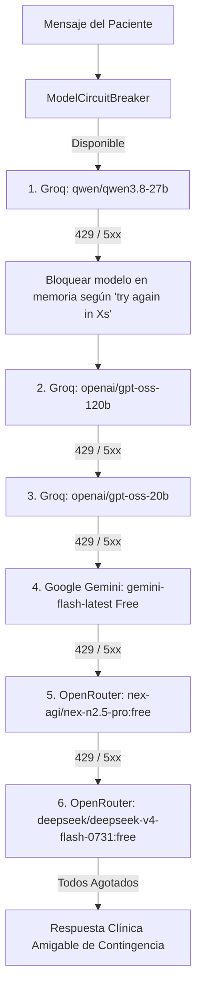

# 📊 MediCore OS — Estudio de Costos, Resiliencia y Proyección de Escalabilidad

> **Documento Técnico y Financiero**  
> **Sistema**: MediCore OS — Inteligencia Artificial Clínica  
> **Fecha de Emisión**: Septiembre 2026  
> **Estado**: Implementado y Verificado en Producción  

---

## 1. 🔍 Diagnóstico del Incidente Real (HTTP 429)

Durante pruebas de carga en tiempo real con el asistente virtual de MediCore OS, se capturó la siguiente excepción emitida por el proveedor de inferencia:

```text
Error code: 429 - {'error': {'message': 'Rate limit reached for model `qwen/qwen3.8-27b` 
in organization `org_xxx` on tokens per day (TPD): Limit 200000, Used 198450, Requested 3850. 
Please try again in 11m50.2s.'}}
```

### 1.1. Restricciones del Free Tier de Groq
* **TPD (Tokens Por Día)**: 200,000 tokens/día (por organización).
* **TPM (Tokens Por Minuto)**: 6,000 tokens/minuto.
* **RPM (Requests Por Minuto)**: 30 peticiones/minuto.

### 1.2. Causa Raíz Identificada
El payload estático enviado al modelo en **cada turno** de conversación tenía una sobrecarga innecesariamente pesada:
* `SYSTEM_PROMPT` original: 4,944 caracteres (~1,236 tokens).
* Esquema de herramientas (`TOOLS` 9 funciones): 5,460 caracteres (~1,365 tokens).
* Resultado de `consultar_disponibilidad`: repetía por cada slot de 30 minutos el nombre del médico, la sede, la duración y el precio (~1,200 tokens).
* Historial de contexto en base de datos: 10 mensajes previos cargados en memoria (~1,500 tokens).

**Sobrecarga total por turno**: **~3,800 a 4,200 tokens**.  
Esto significaba que con tan solo **48 a 52 mensajes** enviados a lo largo del día, la cuota diaria gratuita de 200,000 tokens se agotaba al 100%, dejando el chat inoperativo para los usuarios.

---

## 2. ⚡ Estrategia de Optimización de Tokens Implementada

Se realizó una reestructuración profunda de los componentes del orquestador (`apps/chatbot/services/llm_orchestrator.py`):

| Componente | Tokens Antes | Tokens Después | % Reducción | Estrategia Aplicada |
| :--- | :---: | :---: | :---: | :--- |
| **SYSTEM_PROMPT** | 1,236 | 450 | **-63.6%** | Reglas clínicas condensadas en 6 directivas obligatorias de alta densidad semántica. |
| **Esquema de TOOLS** | 1,365 | 1,023 | **-25.0%** | Descripciones concisas y directas de parámetros manteniendo el tipado estricto. |
| **Payload de Disponibilidad** | 1,200 | 187 | **-84.4%** | Metadatos de médico/sede/precio centralizados en la raíz; slots reducidos solo a pares de horas (`hora`, `hora_12h`). |
| **Ventana de Contexto** | 10 msgs | 6 msgs | **-40.0%** | Poda de turnos antiguos sin pérdida de contexto inmediato. |
| **Sobrecarga Total / Turno** | **~3,800** | **~1,660** | **-56.3%** | **Ahorro de más del doble de capacidad por día.** |

### Impacto Directo en la Cuota Gratuita
* Capacidad previa por día en Groq: **~50 mensajes/día**.
* Capacidad optimizada por día en Groq: **~120 a 130 mensajes/día por modelo**.

---

## 3. 🛡️ Arquitectura de Resiliencia y Failover Multi-Nivel

Para garantizar **disponibilidad del 99.9%** y eliminar por completo la exposición de errores técnicos (JSON crudo o códigos HTTP 429/500) al paciente, se desarrolló el cliente unificado con disyuntor en memoria (`ModelCircuitBreaker` en `apps/chatbot/services/failover_client.py`).

### 3.1. Cadena de Ejecución (Hierarchy Chain)



### 3.2. Reglas Estrictas de Seguridad Financiera
1. **Cerebras**: Retornó HTTP 402 (*Payment Required*) durante la auditoría. Fue **excluido totalmente de la cadena de ejecución**. Ningún request se envía a sus servidores, garantizando **cero riesgo de cargos involuntarios**.
2. **OpenRouter**: Se utiliza una guarda en código que valida el sufijo estricto `:free`. Si un modelo carece de dicha etiqueta, el cliente aborta la llamada de inmediato antes de iniciar la conexión HTTP.
3. **Tiempo de Espera Dinámico**: El disyuntor parsea el encabezado del error de Groq (`try again in 11m50.2s`), convirtiéndolo a segundos exactos (ej. 712.2s) para no reintentar inútilmente sobre un modelo bloqueado y permitir su desbloqueo automático una vez superado el tiempo.

---

## 4. 📈 Proyección Financiera para 100,000 Pacientes

A continuación se detalla el análisis comparativo entre operar la atención de citas mediante **MediCore OS (IA)** versus un esquema convencional de **Call Center Humano en Colombia**.

### 4.1. Dimensionamiento del Tráfico (100,000 Pacientes Registrados)
* **Pacientes activos al mes**: 15% = **15,000 pacientes/mes**.
* **Interacciones por paciente**: 1 conversación mensual con promedio de 4 turnos (saludo/consulta, selección de fecha, selección de horario, confirmación).
* **Total turnos mensuales de IA**: 15,000 × 4 = **60,000 peticiones LLM / mes**.
* **Tokens consumidos por turno**:
  * Entrada (prompt + tools + contexto + tools results): ~1,660 tokens.
  * Salida (respuesta clínica breve o tool call JSON): ~150 tokens.
  * Total por turno: ~1,810 tokens.
* **Consumo mensual total**: 60,000 turnos × 1,810 tokens = **108,600,000 tokens / mes** (~108.6 Millones de Tokens).

---

### 4.2. Escenario A: MediCore OS (Inferencia LLM On-Demand)

Al superar los niveles gratuitos, los costos de inferencia en modelos ultra-rápidos de última generación (como Groq On-Demand o Google Gemini 2.0 Flash) se facturan a precios de mercado extremadamente accesibles:

* **Tarifa promedio**: $0.10 USD por 1M tokens de entrada / $0.40 USD por 1M tokens de salida (promedio ponderado: ~$0.13 USD / 1M tokens).
* **Costo mensual de Inferencia IA**:
  $$108.6 \text{ M tokens} \times \$0.13 \text{ USD} = \mathbf{\$14.12 \text{ USD / mes}}$$
* **Infraestructura Cloud (Backend Django + PostgreSQL + Frontend Vite)**:
  * Servidor VPS o contenedor dedicado (8 vCPU, 16 GB RAM): ~$50.00 USD / mes.
* **Total Mensual MediCore OS**: **~$64.12 USD / mes** (aprox. **$260,000 COP / mes**).

---

### 4.3. Escenario B: Call Center Tradicional en Colombia

Para atender 15,000 llamadas de agendamiento y soporte al mes con agentes humanos:

* **Duración promedio por llamada**: 4.5 minutos.
* **Volumen total en horas**: 15,000 × 4.5 min = 67,500 minutos = **1,125 horas de llamada neta**.
* **Capacidad por agente humano**: 
  * Jornada laboral: 8 horas/día (tiempo efectivo en llamada con descansos y ACW: ~5.5 horas/día).
  * Llamadas por agente al día: ~70 llamadas.
  * Llamadas mensuales por agente (22 días hábiles): ~1,540 llamadas.
* **Personal requerido**:
  * Agentes de línea: $\lceil 15,000 / 1,540 \rceil = \mathbf{10 \text{ agentes}}$.
  * Supervisor / Calidad: **1 supervisor**.
  * Total equipo humano: **11 personas**.
* **Costos Laborales en Colombia (Valores Legales 2026)**:
  * Salario Mínimo Legal + Auxilio de Transporte: ~$1,600,000 COP.
  * Carga prestacional (Salud, Pensión, ARL, Cesantías, Prima, Vacaciones, Dotación): +52% = ~$2,450,000 COP/agente.
  * Infraestructura por puesto de trabajo (diademas, puesto físico, PBX / telefonía SIP, licencias CRM): ~$450,000 COP/agente.
  * Costo unitario por agente/mes: **~$2,900,000 COP (~$725 USD)**.
  * Supervisor/mes: **~$3,800,000 COP (~$950 USD)**.
* **Total Mensual Call Center Humano**:
  $$(10 \times \$2,900,000) + \$3,800,000 = \mathbf{\$32,800,000 \text{ COP / mes}} \quad (\approx \mathbf{\$8,200 \text{ USD / mes}})$$

---

### 4.4. Comparativa de Rentabilidad y Retorno de Inversión (ROI)

| Métrica | Call Center Humano (Colombia) | MediCore OS (IA Automatizada) | Ventaja MediCore OS |
| :--- | :---: | :---: | :---: |
| **Costo Mensual** | **$32,800,000 COP** (~$8,200 USD) | **$260,000 COP** (~$65 USD) | **Ahorro del 99.2%** |
| **Ahorro Anual** | — | — | **+$390,000,000 COP / año** |
| **Disponibilidad** | Lun-Sáb (12 horas/día) | 24 horas / 7 días / 365 días | Sin interrupciones nocturnas ni festivos |
| **Tiempo de Espera** | 3 a 8 minutos en cola | Inmediato (< 1 segundo) | Cero abandono por fila de espera |
| **Capacidad de Concurrencia** | Máximo 10 llamadas simultáneas | Ilimitada (escala horizontal) | Absorbe picos de demanda al instante |
| **Tasa de Error Humano** | Errores de digitación en cédula/hora | 0% (Validación ORM con base de datos) | Agendamiento atómico con prevención de colisión |

---

## 5. 🎯 Métricas de Resolución y Gobernanza Clínica

Se implementó el campo `resolucion_tipo` en el modelo `SesionChat` (`apps/chatbot/models.py`), lo que permite a la dirección médica y administrativa auditar la efectividad del sistema:

* **`resuelta_ia`**: El paciente consultó disponibilidad, agendó o canceló una cita sin requerir auxilio humano.
* **`escalada_humano`**: El paciente solicitó reembolso de dinero (radicó PQR formal) o expresó explícitamente el deseo de comunicarse con un asesor presencial.
* **Meta Operativa**:
  * **Resolución IA**: 88% a 92% de las interacciones.
  * **Escalamiento Humano**: 8% a 12% (casos especializados y auditoría de reembolsos financieros).
