# 📊 DIAGRAMA DE BASE DE DATOS ACTUALIZADO — MEDICORE OS

> **Entregable Obligatorio de Modelado de Datos**  
> **Sistema**: MediCore OS  
> **Formato**: Diagrama Entidad-Relación Mermaid (exportable como imagen SVG/PNG) + Diccionario de Cardinalidades y Relaciones.  
> **DDL SQL Completo**: Disponible también en [`docs/schema_postgres.sql`](file:///c:/Users/Jeison%20-%20PC/Documents/Gestor%20Medico%20Inteligente/docs/schema_postgres.sql).

---

## 1. 📐 Diagrama Entidad-Relación Completo (Mermaid)

```mermaid
erDiagram
    %% ==========================================
    %% IDENTIDAD, ROLES Y ACCESO
    %% ==========================================
    Rol ||--o{ Usuario : "asigna rol principal"
    Rol ||--o{ RolPermiso : "contiene"
    Permiso ||--o{ RolPermiso : "asignado a"

    Usuario ||--o| Paciente : "perfil paciente (1:1)"
    Usuario ||--o| Medico : "perfil medico (1:1)"
    Usuario ||--o{ SesionChat : "inicia conversaciones"
    Usuario ||--o{ RegistroAuditoria : "auditoria de usuario"

    %% ==========================================
    %% INFRAESTRUCTURA CLINICA
    %% ==========================================
    Sede ||--o{ Medico : "sede de trabajo"
    Sede ||--o{ Cita : "lugar de consulta"
    Especialidad ||--o{ Medico : "especialidad medica"
    Medico ||--o{ HorarioMedico : "agenda semanal base"

    %% ==========================================
    %% GESTION CLINICA Y CITAS
    %% ==========================================
    EstadoCita ||--o{ Cita : "estado de cita"
    Medico ||--o{ Cita : "atiende cita"
    Paciente ||--o{ Cita : "reserva cita"
    Cita ||--o| ConsultaNota : "evolucion medica (1:1)"

    %% ==========================================
    %% FACTURACION Y PAGOS
    %% ==========================================
    MetodoPago ||--o{ Pago : "canal de pago"
    EstadoPago ||--o{ Pago : "estado contable"
    Cita ||--o| Pago : "comprobante de pago (1:1)"

    %% ==========================================
    %% PQR Y REEMBOLSOS
    %% ==========================================
    TipoPQR ||--o{ PQRSolicitud : "clasifica tipo"
    EstadoPQR ||--o{ PQRSolicitud : "fase de solicitud"
    Cita ||--o{ PQRSolicitud : "cita objeto de reclamo"
    Paciente ||--o{ PQRSolicitud : "radicado por paciente"

    %% ==========================================
    %% CHATBOT IA
    %% ==========================================
    SesionChat ||--o{ MensajeChat : "historial de mensajes"

    %% ==========================================
    %% DEFINICION DE ENTIDADES Y ATRIBUTOS
    %% ==========================================
    Usuario {
        UUID id PK "Identificador universal"
        string correo UK "Correo electrónico único"
        string password_hash "Contraseña cifrada con Bcrypt"
        string nombre_completo "Nombre del usuario"
        string rol FK "Clave foránea a tabla roles"
        string telefono "Teléfono de contacto"
        boolean activo "Flag de activación"
        datetime creado_en "Fecha de registro"
    }

    Rol {
        string codigo PK "'paciente', 'medico', 'admin', 'agente_atencion'"
        string nombre "Nombre descriptivo"
        string descripcion "Alcance del rol"
        boolean activo "Flag habilitado"
    }

    Permiso {
        string codigo PK "'citas.agendar', 'auditoria.ver', etc."
        string nombre "Nombre del permiso"
        string modulo "Módulo del sistema"
        string descripcion "Descripción técnica"
    }

    RolPermiso {
        UUID id PK "Identificador primario"
        string rol_codigo FK "Clave foránea a roles"
        string permiso_codigo FK "Clave foránea a permisos"
    }

    Paciente {
        UUID id PK "Identificador universal"
        UUID usuario_id FK "Relación 1:1 con Usuario"
        string documento_tipo "CC, TI, CE, PAS"
        string documento_numero UK "Identificación única nacional"
        date fecha_nacimiento "Fecha de nacimiento"
        string contacto_emergencia "Nombre de acudiente"
        string telefono_emergencia "Teléfono de emergencia"
    }

    Medico {
        UUID id PK "Identificador universal"
        UUID usuario_id FK "Relación 1:1 con Usuario"
        UUID especialidad_id FK "Especialidad asignada"
        UUID sede_id FK "Sede hospitalaria asignada"
        string tarjeta_profesional UK "Registro médico nacional"
        int duracion_cita_minutos "Duración de turno (ej. 30)"
        string genero "M o F"
        boolean activo "Disponibilidad profesional"
    }

    Sede {
        UUID id PK "Identificador universal"
        string nombre "Nombre del centro médico"
        string direccion "Ubicación física"
        string telefono "Teléfono de la sede"
        boolean activa "Flag de sede activa"
    }

    Especialidad {
        UUID id PK "Identificador universal"
        string nombre UK "Nombre de la especialidad"
        text descripcion "Descripción del servicio"
        decimal precio_base "Arancel base en COP"
    }

    HorarioMedico {
        UUID id PK "Identificador universal"
        UUID medico_id FK "Médico titular"
        string dia "lunes, martes, etc."
        time hora_inicio "Hora de apertura de consulta"
        time hora_fin "Hora de cierre de consulta"
    }

    EstadoCita {
        string codigo PK "'pendiente_pago', 'confirmada', 'cancelada', 'atendida', 'no_asistio'"
        string nombre "Nombre oficial"
        string descripcion "Descripción del estado"
        boolean activo "Flag activo"
    }

    Cita {
        UUID id PK "Identificador de cita"
        UUID paciente_id FK "Paciente solicitante"
        UUID medico_id FK "Médico asignado"
        UUID sede_id FK "Sede física de la consulta"
        string estado FK "Clave foránea a estados_cita"
        datetime fecha_hora "Fecha y hora programada"
        int duracion_minutos "Duración en minutos"
        text motivo "Motivo de la consulta"
        datetime creado_en "Fecha de registro"
    }

    ConsultaNota {
        UUID id PK "Identificador de nota médica"
        UUID cita_id FK "Cita médica asociada (1:1)"
        text diagnostico "Juicio diagnóstico CIE"
        text tratamiento "Plan terapéutico"
        text receta_medica "Prescripción de medicamentos"
        datetime creado_en "Fecha de registro de la nota"
    }

    EstadoPago {
        string codigo PK "'pendiente', 'aprobado', 'completado', 'rechazado', 'reembolsado'"
        string nombre "Nombre del estado contable"
        string descripcion "Descripción"
    }

    MetodoPago {
        string codigo PK "'sandbox', 'tarjeta_credito', 'pse', 'wompi'"
        string nombre "Nombre de la pasarela"
        string descripcion "Descripción"
        boolean activo "Flag de disponibilidad"
    }

    Pago {
        UUID id PK "Identificador del cobro"
        UUID cita_id FK "Cita liquidada (1:1)"
        decimal monto "Valor facturado inmutable"
        string moneda "COP"
        string referencia UK "Código único de transacción"
        string metodo_pago FK "Pasarela de pago utilizada"
        string estado FK "Estado contable del pago"
        datetime actualizado_en "Última actualización"
    }

    TipoPQR {
        string codigo PK "'reembolso', 'peticion', 'queja', 'reclamo'"
        string nombre "Nombre del trámite"
        string descripcion "Descripción legal"
    }

    EstadoPQR {
        string codigo PK "'pendiente_revision', 'aprobada', 'rechazada'"
        string nombre "Fase del trámite"
        string descripcion "Descripción"
    }

    PQRSolicitud {
        UUID id PK "Radicado de solicitud"
        UUID cita_id FK "Cita objeto de reclamación"
        UUID paciente_id FK "Paciente titular"
        string tipo FK "Clave foránea a tipos_pqr"
        string estado FK "Clave foránea a estados_pqr"
        text motivo "Sustento de la solicitud"
        datetime creado_en "Fecha de radicación"
    }

    SesionChat {
        UUID id PK "Identificador de sesión"
        UUID usuario_id FK "Usuario conversando"
        string rol_origen "Rol en la conversación"
        string resolucion_tipo "resuelta_ia, escalada_humano"
        json estado_flujo "Estado del flujo determinista"
        datetime creado_en "Fecha de inicio"
    }

    MensajeChat {
        UUID id PK "Identificador de mensaje"
        UUID sesion_id FK "Sesión a la que pertenece"
        string emisor "usuario o asistente"
        text contenido "Texto del mensaje"
        string requiere_seleccion "ninguna, dia, hora"
        json metadata_ui "Slots de hora y días interactivos"
        datetime creado_en "Timestamp del mensaje"
    }

    RegistroAuditoria {
        UUID id PK "Identificador de auditoría"
        UUID usuario_id FK "Usuario ejecutor (nullable)"
        string rol_en_el_momento "Rol snapshot histórico"
        string accion "Código indexado de la acción"
        string entidad_tipo "Cita, Pago, Sede, Medico, etc."
        string entidad_id "UUID de la entidad afectada"
        datetime timestamp "Marca temporal exacta"
        json datos_cambio "Estado anterior -> nuevo"
        string origen "bot_llm, humano_paciente, humano_admin, etc."
        string ip "Dirección IP del cliente"
        string session_id "Sesión conversacional si aplica"
    }
```



---

## 2. 🔢 Diccionario de Cardinalidades y Claves

| Relación | Entidad Padre | Entidad Hija | Cardinalidad | Clave Primaria (PK) | Clave Foránea (FK) | Comportamiento `ON DELETE` |
|:---|:---|:---|:---:|:---|:---|:---|
| **Usuario ↔ Rol** | `roles` | `usuarios` | 1 a N | `roles.codigo` | `usuarios.rol` | `PROTECT` |
| **Rol ↔ Permiso** | `roles` / `permisos` | `roles_permisos` | N a M | `roles_permisos.id` | `rol_id`, `permiso_id` | `CASCADE` |
| **Usuario ↔ Paciente** | `usuarios` | `pacientes` | 1 a 1 | `pacientes.id` | `pacientes.usuario_id` | `CASCADE` |
| **Usuario ↔ Médico** | `usuarios` | `medicos` | 1 a 1 | `medicos.id` | `medicos.usuario_id` | `CASCADE` |
| **Sede ↔ Médico** | `sedes` | `medicos` | 1 a N | `sedes.id` | `medicos.sede_id` | `CASCADE` |
| **Especialidad ↔ Médico** | `especialidades` | `medicos` | 1 a N | `especialidades.id` | `medicos.especialidad_id` | `CASCADE` |
| **Médico ↔ Horario** | `medicos` | `horarios_medico` | 1 a N | `horarios_medico.id` | `horarios_medico.medico_id` | `CASCADE` |
| **Paciente ↔ Cita** | `pacientes` | `citas` | 1 a N | `citas.id` | `citas.paciente_id` | `CASCADE` |
| **Médico ↔ Cita** | `medicos` | `citas` | 1 a N | `citas.id` | `citas.medico_id` | `CASCADE` |
| **Sede ↔ Cita** | `sedes` | `citas` | 1 a N | `citas.id` | `citas.sede_id` | `CASCADE` |
| **EstadoCita ↔ Cita** | `estados_cita` | `citas` | 1 a N | `estados_cita.codigo` | `citas.estado` | `PROTECT` |
| **Cita ↔ ConsultaNota** | `citas` | `consultas_notas` | 1 a 1 | `consultas_notas.id` | `consultas_notas.cita_id` | `CASCADE` |
| **Cita ↔ Pago** | `citas` | `pagos` | 1 a 1 | `pagos.id` | `pagos.cita_id` | `CASCADE` |
| **EstadoPago ↔ Pago** | `estados_pago` | `pagos` | 1 a N | `estados_pago.codigo` | `pagos.estado` | `PROTECT` |
| **MetodoPago ↔ Pago** | `metodos_pago` | `pagos` | 1 a N | `metodos_pago.codigo` | `pagos.metodo_pago` | `PROTECT` |
| **Cita ↔ PQRSolicitud** | `citas` | `pqr_solicitudes` | 1 a N | `pqr_solicitudes.id` | `pqr_solicitudes.cita_id` | `CASCADE` |
| **TipoPQR ↔ PQRSolicitud** | `tipos_pqr` | `pqr_solicitudes` | 1 a N | `tipos_pqr.codigo` | `pqr_solicitudes.tipo` | `PROTECT` |
| **EstadoPQR ↔ PQRSolicitud**| `estados_pqr` | `pqr_solicitudes` | 1 a N | `estados_pqr.codigo` | `pqr_solicitudes.estado` | `PROTECT` |
| **Usuario ↔ SesionChat** | `usuarios` | `sesiones_chat` | 1 a N | `sesiones_chat.id` | `sesiones_chat.usuario_id` | `CASCADE` |
| **SesionChat ↔ MensajeChat**| `sesiones_chat` | `mensajes_chat` | 1 a N | `mensajes_chat.id` | `mensajes_chat.sesion_id` | `CASCADE` |
| **Usuario ↔ Auditoria** | `usuarios` | `auditoria_registros` | 1 a N | `auditoria_registros.id`| `auditoria_registros.usuario_id` | `SET_NULL` |

---

## 3. 🖼️ Cómo exportar este diagrama a imagen (PNG / SVG)

Puedes generar una imagen de alta definición de este diagrama con cualquiera de estos métodos:
1. **Mermaid Live Editor**: Copia el bloque ```mermaid de la Sección 1 y pégalo en [https://mermaid.live](https://mermaid.live). Haz clic en **Actions -> Download PNG / SVG**.
2. **Extensión de VS Code / IDE**: Instala *Markdown Preview Mermaid Support* para visualizarlo directamente en el editor.
3. **Mermaid CLI (Automatizado)**:
   ```bash
   npx -y @mermaid-js/mermaid-cli -i DIAGRAMA_ER.md -o diagrama_er.png
   ```
