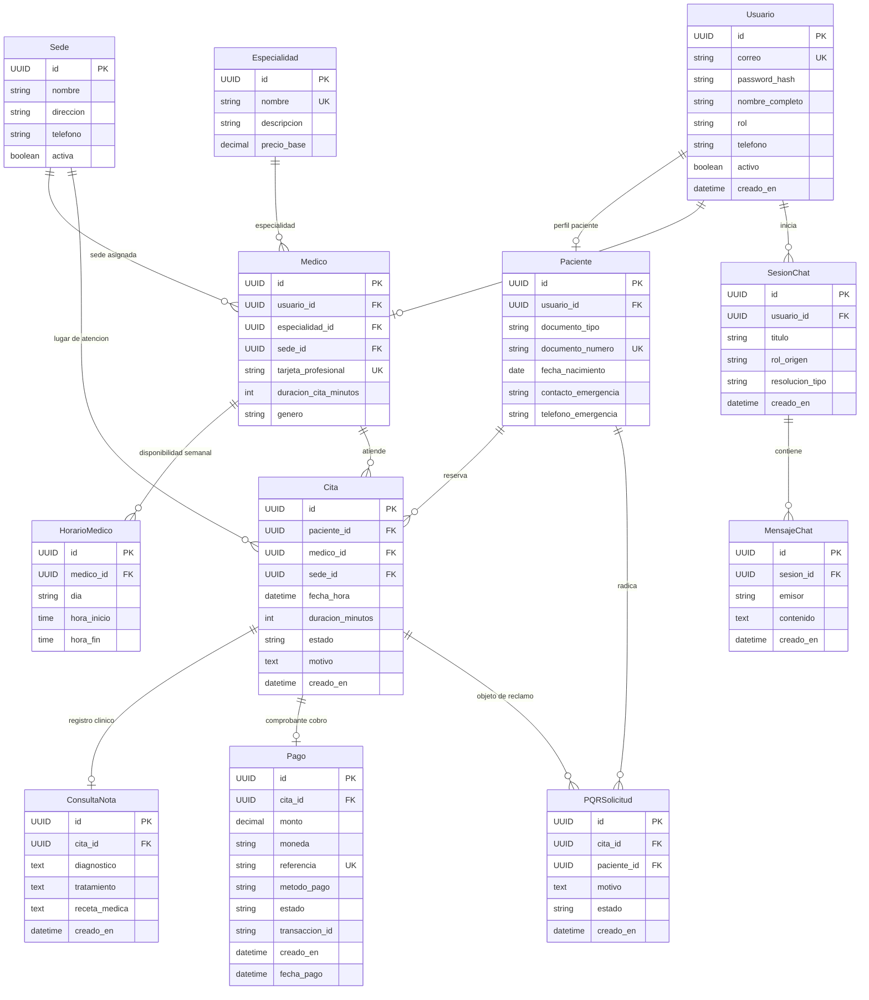

# 🏥 MediCore OS — Arquitectura del Sistema, Modelos y Flujo Clínico con IA

> **Documento Técnico y Guía Didáctica**  
> **Sistema**: MediCore OS — Asistente Clínico Inteligente  
> **Backend**: Django 5.1 + Django REST Framework + LLM Failover Orquestador  
> **Frontend**: Angular 19 (Standalone Components, Signals, Tailwind CSS)  
> **Fecha**: Septiembre 2026  

---

## 1. 🗺️ Mapa de Aplicaciones, Modelos y Relaciones (Diagrama ER)

El backend de MediCore OS está modularizado en aplicaciones de Django desacopladas bajo el directorio `backend/apps/`:

1. **`authentication`**: Control de cuentas de usuario, credenciales cifradas con bcrypt y tokens JWT.
2. **`clinica`**: Catálogos base de sedes, especialidades médicas, profesionales de la salud (médicos), agendas base y perfiles de pacientes.
3. **`citas`**: Transacciones de agendamiento, disponibilidad de horarios, notas clínicas y solicitudes PQR/reembolsos.
4. **`pagos`**: Gestión de cobros, transacciones simuladas y estados financieros asociados a las citas.
5. **`chatbot`**: Sesiones y mensajes de conversación, historial persistente y orquestación LLM multi-proveedor.

### Diagrama Entidad-Relación (Mermaid)



---

## 2. 🔄 Flujo Completo del Chat con IA

El flujo de interacción del paciente o usuario médico con el copiloto inteligente sigue una ruta estructurada de 6 etapas:

```
[1. Frontend (Angular)]
       │  POST /api/chat/mensaje  { mensaje, sesion_id? } + Bearer Token
       ▼
[2. View: EnviarMensajeView (Django)]
       │  Valida autenticación (JWT) y existencia/propiedad de la sesión
       │  Persiste mensaje del usuario en tabla `mensajes_chat`
       ▼
[3. Orquestador: LLMOrchestrator.chat()]
       │  Recupera contexto histórico (últimos 6 mensajes para control de tokens)
       │  Inyecta SYSTEM_PROMPT dinámico con directivas clínicas
       │  Ensambla esquemas de herramientas JSON (TOOLS: 9 funciones)
       ▼
[4. Cliente Resiliente: UnifiedLLMClient & ModelCircuitBreaker]
       │  Intenta inferencia en cadena de prioridades (Groq -> Gemini -> OpenRouter)
       │  Detecta HTTP 429 / Rate Limit y bloquea el modelo temporalmente
       │  Ejecuta Tool Calling determinista (consultar_disponibilidad, agendar_cita, etc.)
       │  Máximo 3 iteraciones de loop anti-recursión
       ▼
[5. Post-procesamiento y Salvaguardas]
       │  Verificación de colisiones y reservas automáticas si el LLM olvidó invocar el tool
       │  Generación de metadatos interactivos (requiere_seleccion, dias_disponibles, horarios)
       │  Persiste respuesta del asistente en `mensajes_chat` y actualiza métrica de resolución
       ▼
[6. Frontend Angular]
       │  Recibe JSON estructurado: { respuesta, sesion_id, requiere_seleccion, ... }
       │  Renderiza burbujas, botones de horario clicables o calendario interactivo
       │  Si actualizo_citas = true: dispara recarga en tiempo real de widgets de citas
```

---

## 3. 🧠 SYSTEM_PROMPT y Marcadores (`<!--CALENDAR:...-->` y `<!--SLOTS:...-->`)

### 3.1. Rol del `SYSTEM_PROMPT`
El prompt del sistema actúa como guardián de comportamiento:
1. **Zero-Hallucination**: Obliga al LLM a no inventar horarios. Si un tool retorna 0 cupos, debe declarar explícitamente la indisponibilidad.
2. **Brevedad y Empatía**: Limita la respuesta a 1-3 oraciones directas sin jerga técnica de APIs.
3. **Seguridad Clínica**: Prohíbe formalmente recetar medicamentos y emitir diagnósticos definitivos.
4. **Reglas de Agendamiento**: Prohíbe declarar una cita como agendada sin haber ejecutado exitosamente `agendar_cita`.

### 3.2. Origen e Interpretación de Marcadores Históricos
* **¿Quién los generaba?**:
  El orquestador del backend (`llm_orchestrator.py`), al detectar que una herramienta devolvía slots de 12 horas o un catálogo de días disponibles, agregaba al final del texto cadenas como:
  ```text
  \n<!--SLOTS:["08:00 a. m.", "09:30 a. m."]--!>
  \n<!--CALENDAR:{"especialidad": "Medicina General", "dias_disponibles": ["2026-10-01"]}--!>
  ```
* **¿Quién los interpretaba?**:
  El componente frontend (anteriormente en React y ahora migrado a Angular) leía el texto con expresiones regulares `re.match(/<!--SLOTS:(.*?)-->/)`, limpiaba el texto para el usuario y creaba botones.
* **El problema de raíz**:
  Si el texto contenía palabras como "agendada", "confirmada" o "no hay", se producían colisiones de expresiones regulares y parches de palabras clave. En la **Fase 5**, esta arquitectura pasa a ser 100% estructurada en el payload JSON (`requiere_seleccion: 'dia' | 'hora' | 'ninguna'`).

---

## 4. 🛡️ Matriz de Validaciones Existentes y Análisis de Riesgo

| Validación | Ubicación en el Código | Propósito Técnico | ¿Qué pasaría si se quita? (Impacto Real) |
| :--- | :--- | :--- | :--- |
| **Colisión de Citas (Horario Ocupado)** | `citas/views.py` (`CitaCreateView`), `citas/services.py`, `llm_orchestrator.py` | Verifica que ningún médico tenga otra cita activa (`pendiente_pago` o `confirmada`) en el mismo rango de fecha y hora. | **Doble agendamiento crítico**: dos pacientes llegarían al consultorio a la misma hora para el mismo médico. Caos operativo en recepción. |
| **Pertenencia de Paciente / Cita** | `citas/views.py` (`MisCitasView`), `citas/services.py` | Filtra las citas en BD exclusivamente por el `paciente_id` o `medico_id` del usuario autenticado. | **Fuga de privacidad (HIPAA / Habeas Data)**: cualquier paciente podría ver historias clínicas, motivos y citas de otros pacientes. |
| **Verificación de Cifrado Bcrypt** | `authentication/models.py` (`check_password_compatible`) | Trunca contraseñas a 72 bytes según el estándar de bcrypt y valida el salt contra el hash almacenado. | **Brecha de autenticación**: las contraseñas podrían ser vulnerables o no validar usuarios preexistentes de FastAPI/Django. |
| **Cancelación de Citas Pagadas** | `llm_orchestrator.py` (`_tool_cancelar_cita`), `citas/views.py` | Impide que una cita en estado `confirmada` (con pago realizado) sea cancelada unilateralmente por el chat sin generar un PQR formal. | **Pérdida financiera y descontrol de tesorería**: el sistema liberaría citas sin procesar el reembolso bancario, causando reclamos legales. |
| **Formato Estricto de Fecha/Hora** | `citas/services.py` (`get_disponibilidad`), `citas/serializers.py` | Valida que la fecha cumpla `YYYY-MM-DD` y la hora corresponda al bloque exacto de duración de la cita (ej. 30 o 45 min). | **Inconsistencia en BD**: inserción de fechas nulas o citas de duraciones irregulares fuera del horario laboral del médico. |
| **Cuenta Activa (`activo=True`)** | `authentication/views.py` (`LoginView`) | Valida el flag booleano de activación antes de generar el token JWT. | **Acceso no autorizado**: usuarios o médicos despedidos/suspendidos podrían seguir accediendo a agendas y datos clínicos. |
| **Límite de Contexto de Chat (6 msgs)** | `chatbot/services/llm_orchestrator.py` | Poda el historial enviado al LLM a los últimos 6 mensajes del hilo. | **Saturación inmediata de tokens y error HTTP 429**: el free-tier de Groq (200k TPD) colapsaría tras 40 mensajes al día. |

---

## 5. ⚠️ Riesgos y Deuda Técnica Encontrada

1. **Campos de Estado como Cadenas Abiertas (Violación de Normalización)**:
   Los modelos `Cita` (`estado`), `Pago` (`estado`, `metodo_pago`) y `PQRSolicitud` (`estado`) usan `CharField` con `choices` en Python, pero a nivel de base de datos SQL son cadenas de texto libre sin claves foráneas a tablas de catálogo. Si un script o migración inserta un valor tipográfico erróneo, la lógica de negocio se rompe silenciosamente.
2. **Roles Almacenados como String en `Usuario.rol`**:
   No existe una tabla de roles ni una matriz relacional de permisos en base de datos. El control de acceso está acoplado a comparaciones manuales de strings (`if user.rol == 'paciente'`).
3. **Ausencia de Registro de Auditoría Inmutable**:
   No existe una tabla que registre quién canceló una cita, quién aprobó un reembolso o cuándo el bot de IA ejecutó una acción sobre la agenda médica.
4. **Dependencia Histórica de Expresiones Regulares en el Frontend**:
   El frontend analizaba texto con expresiones regulares heurísticas para adivinar si debía pintar un calendario o botones de horario, lo que provocaba bugs intermitentes al confirmar citas.

---

*Documento elaborado como línea base de ingeniería previa a la Normalización (Fase 2) y Control de Roles (Fase 3).*
