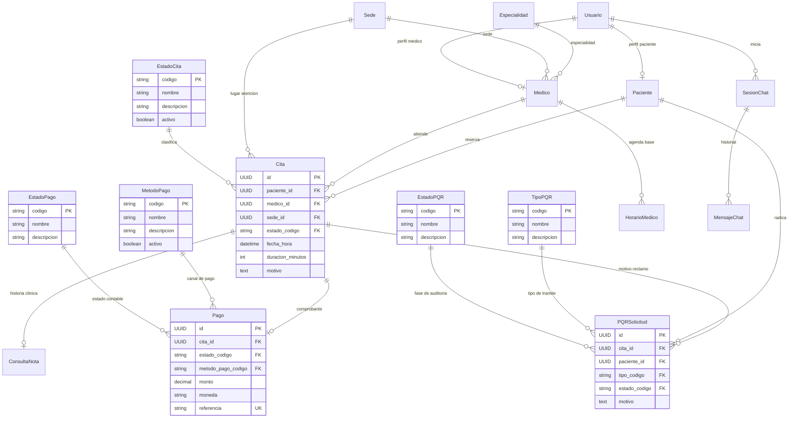

# 🗄️ MediCore OS — Normalización de Base de Datos (1FN, 2FN, 3FN)

> **Documento de Diseño Relacional y Normalización**  
> **Sistema**: MediCore OS  
> **Fase**: Fase 2 — Normalización y Catálogos Relacionales  
> **Fecha**: Septiembre 2026  

---

## 1. 🔍 Diagnóstico del Esquema Anterior y Violaciones Detectadas

Antes de la Fase 2, el sistema almacenaba múltiples entidades y conceptos de dominio como cadenas de texto libre (`CharField` con `choices` a nivel de aplicación en Python), careciendo de restricciones a nivel de base de datos relacional.

### Violaciones Identificadas:

1. **Violación de Integridad de Dominio y 1FN / 3FN en Estados de Cita (`citas.estado`)**:
   - *Antes*: `Cita.estado = models.CharField(max_length=20, default='pendiente_pago')`.
   - *Problema*: La base de datos aceptaba cualquier string. No existía catálogo relacional de estados permitidos, descripciones oficiales ni flags de activación.
   - *Riesgo*: Scripts directos o integraciones externas podían insertar estados inconsistentes (ej: `"confirmado"`, `"pagada"`), rompiendo los filtros del orquestador y la interfaz de usuario.

2. **Violación de 3FN en Solicitudes PQR (`pqr_solicitudes`)**:
   - *Antes*: `PQRSolicitud.estado` era un string plano. No existía tipificación de la solicitud (`reembolso`, `queja`, `peticion`, `reclamo`).
   - *Problema*: La lógica de negocio asumía que todo PQR era un reembolso financiero, mezclando reclamos médicos con devoluciones contables.

3. **Violación de Integridad y 3FN en Pagos (`pagos.metodo_pago` y `pagos.estado`)**:
   - *Antes*: `Pago.metodo_pago` y `Pago.estado` eran `CharField(max_length=50)`.
   - *Problema*: Los nombres de los métodos de pago (`"wompi"`, `"pse"`, `"tarjeta_credito"`, `"sandbox"`) y sus estados estaban desnormalizados, sin control de pasarelas activas.

4. **Carencia de Índices Compuestos Críticos**:
   - Las consultas de disponibilidad de citas y filtros por estado hacían escaneos secuenciales (`seq scan`) al no contar con un índice sobre `(estado, fecha_hora)`.

---

## 2. 🛠️ Solución Implementada: Tablas de Catálogo y Relaciones 3FN

Se crearon tablas de catálogo normalizadas con claves primarias semánticas (`codigo`) y metadatos descriptivos:

### 2.1. Catálogos Creados:
* **`estados_cita` (`EstadoCita`)**:
  - `codigo` (PK): `pendiente_pago`, `confirmada`, `cancelada`, `atendida`, `no_asistio`.
  - `nombre`, `descripcion`, `activo`.
* **`estados_pqr` (`EstadoPQR`)**:
  - `codigo` (PK): `pendiente_revision`, `aprobada`, `rechazada`.
  - `nombre`, `descripcion`.
* **`tipos_pqr` (`TipoPQR`)**:
  - `codigo` (PK): `reembolso`, `peticion`, `queja`, `reclamo`.
  - `nombre`, `descripcion`.
* **`estados_pago` (`EstadoPago`)**:
  - `codigo` (PK): `pendiente`, `aprobado`, `completado`, `rechazado`, `reembolsado`.
  - `nombre`, `descripcion`.
* **`metodos_pago` (`MetodoPago`)**:
  - `codigo` (PK): `sandbox`, `tarjeta_credito`, `pse`, `wompi`, `epayco`.
  - `nombre`, `descripcion`, `activo`.

### 2.2. Claves Foráneas con Protección (`on_delete=models.PROTECT`):
* `Cita.estado` → FK a `EstadoCita` (`db_column='estado'`).
* `PQRSolicitud.estado` → FK a `EstadoPQR` (`db_column='estado'`).
* `PQRSolicitud.tipo` → FK a `TipoPQR`.
* `Pago.estado` → FK a `EstadoPago` (`db_column='estado'`).
* `Pago.metodo_pago` → FK a `MetodoPago` (`db_column='metodo_pago'`).

### 2.3. Nuevos Índices de Rendimiento:
* `idx_citas_estado_fecha` en `citas(estado, fecha_hora)`.
* `idx_pqr_paciente_estado` en `pqr_solicitudes(paciente_id, estado)`.
* `idx_pagos_estado_cita` en `pagos(estado, cita_id)`.
* `idx_pagos_referencia` en `pagos(referencia)`.

---

## 3. 📊 Comparativa: Esquema Antes vs. Esquema Después

| Tabla / Campo | Tipo Antes (Pre-Fase 2) | Tipo Después (Normalizado) | Forma Normal Aplicada | Justificación Técnica |
| :--- | :--- | :--- | :---: | :--- |
| `citas.estado` | `VARCHAR(20)` plano | `FK` a `estados_cita(codigo)` | **3FN** | Elimina redundancia conceptual e impide inserción de estados no autorizados. |
| `pqr_solicitudes.estado` | `VARCHAR(30)` plano | `FK` a `estados_pqr(codigo)` | **3FN** | Valida el ciclo de vida del PQR (pendiente, aprobado, rechazado) en base de datos. |
| `pqr_solicitudes.tipo` | *Inexistente* | `FK` a `tipos_pqr(codigo)` | **2FN / 3FN** | Permite tipificar reclamos, devoluciones de dinero y quejas del servicio. |
| `pagos.estado` | `VARCHAR(20)` plano | `FK` a `estados_pago(codigo)` | **3FN** | Integridad financiera estricta contra pasarelas bancarias. |
| `pagos.metodo_pago` | `VARCHAR(50)` plano | `FK` a `metodos_pago(codigo)` | **3FN** | Habilita o deshabilita pasarelas dinámicamente mediante el flag `activo`. |

---

## 4. 📐 Diagrama Entidad-Relación Normalizado (Mermaid)

---

## 5. 🛡️ Garantía de Preservación de Datos y Contrato API

1. **Uso de `db_column`**:
   Las claves foráneas conservan el mismo nombre de columna física en la base de datos SQL (`estado`, `metodo_pago`), garantizando que no se destruyan datos existentes ni se requiera remapeo de columnas.
2. **Serialización Transparente con `SlugRelatedField`**:
   En `CitaResponseSerializer` y `PagoResponseSerializer`, los campos `estado` y `metodo_pago` retornan exactamente el string semántico esperado (`"confirmada"`, `"pendiente_pago"`, `"sandbox"`), garantizando **CERO cambios disruptivos** para los clientes frontend y el orquestador LLM.
